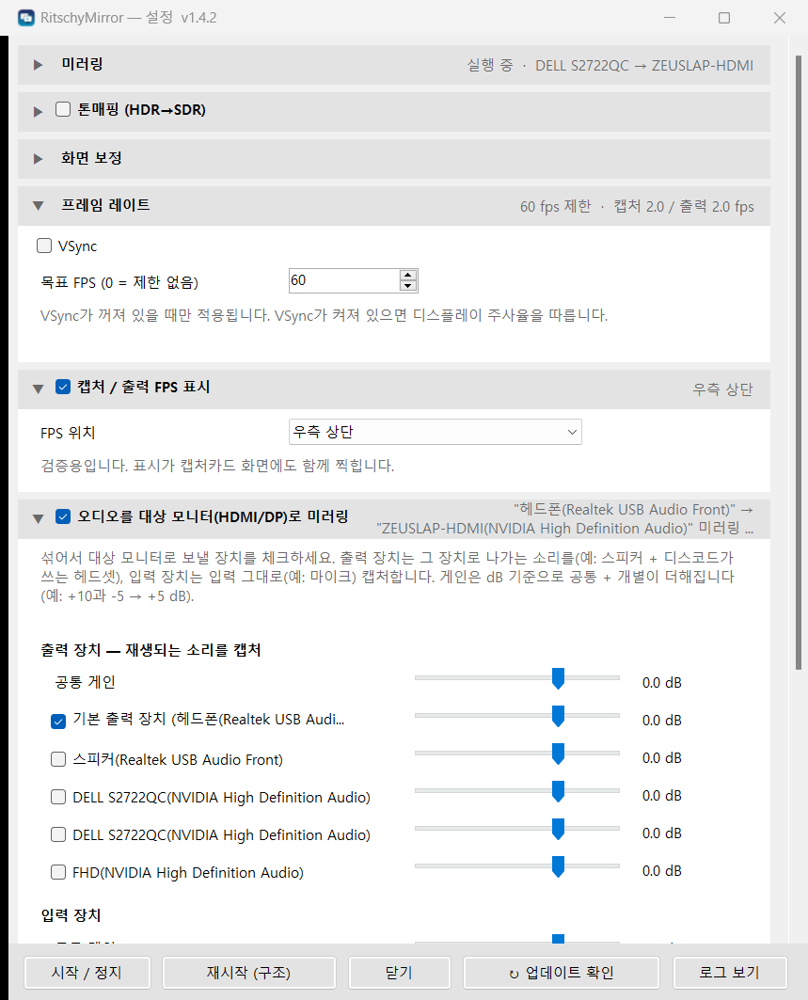

<p align="center">
  
</p>

<h1 align="center">RitschyMirror</h1>

<p align="center">
  <b>어떤 모니터나 창이든 다른 모니터로 미러링 — 캡처카드, 보조 모니터, 휴대용 모니터 무엇이든,
  제대로 된 HDR&nbsp;→&nbsp;SDR 톤매핑과 함께.</b>
</p>

<p align="center"><a href="README.md">English</a> · 한국어</p>

<p align="center">
  <b>투 PC 방송</b>과 <b>보조 모니터 미러링</b>을 위한 가벼운 Windows 도구입니다.<br>
  캡처할 대상을 고르고, 출력 모니터에 깔끔하게 맞춘 뒤, 마우스는 가둬 두면 끝.
</p>

<p align="center">
  
  
  
  
</p>

---

## 어디에 쓰나요?

**투 PC 방송 환경**(게임 PC의 화면을 방송용 두 번째 PC의 캡처카드로 보내는 구성)에서는
보통 **특정 모니터 하나**를 캡처카드로 내보내야 합니다.
흔히 쓰는 방법은 OBS의 *전체화면 프로젝터*지만, 여기에는 분명한 문제가 있습니다.

- 🌫️ 캡처카드가 SDR로 받아 가면 **HDR 화면이 뿌옇고 회색빛**으로 보입니다.
- 📐 **울트라와이드나 해상도가 다른 화면**은 16:9 캡처에 깔끔하게 맞지 않습니다.
- 🖱️ 프로젝터가 디스플레이 하나를 통째로 차지하고, **마우스는 자꾸 그쪽으로 넘어갑니다.**
- 🧩 화면을 OBS가 처리하는 방식에 그대로 묶여 버립니다.

**RitschyMirror**는 바로 이 한 가지 일만 하는 작은 전용 앱이고, 그 일을 더 잘 해냅니다.
모니터를 캡처해 GPU에서 **HDR → SDR 톤매핑**을 하고, 출력 해상도에 맞게 **맞춤 / 레터박스 / 크롭**한 뒤,
필요하면 **출력 모니터에서 마우스를 차단**하고, 결과를 그 모니터로 내보냅니다.

**출력 모니터**는 Windows가 인식하는 디스플레이라면 무엇이든 됩니다. 투 PC 구성에서는 캡처카드의
HDMI 입력이 출력 모니터가 되고(Windows에는 모니터처럼 보입니다), 시청자용 보조 모니터, 휴대용 모니터,
TV로 내보낼 때도 똑같이 쓸 수 있습니다.

> 원래는 제 듀얼 방송 장비에서 OBS 프로젝터를 대체하려고 만들었습니다. 트레이에서 조용히
> 돌아가며, 그냥 알아서 잘 동작합니다. — 원작자

<p align="center">
  
</p>

---

## 기능

- 🎯 드롭다운에서 **캡처 대상 / 출력 모니터 선택** — 실제 모니터 이름(예: *AORUS FO32U2P*)이 표시되며,
  HDR과 멀티 GPU를 인식합니다(캡처와 출력이 **서로 다른 그래픽카드**에 연결되어 있어도 됩니다).
- 🧭 **모니터 캡처 방식 선택** — DXGI Desktop Duplication(기본, 부하 최소) 또는
  Windows.Graphics.Capture(GPU가 달라도 동작, 커서를 Windows가 그림) 중에서 고를 수 있습니다.
- 🪟 **모니터 전체 대신 창 하나 / 전체화면 앱만 미러링**할 수도 있습니다 — 예를 들어 게임 하나만
  고르면 그 창만 출력되므로, **Alt+Tab 해도 바탕화면이 출력 모니터(방송)로 새어 나가지 않습니다.**
  Windows.Graphics.Capture(최신 OS API)를 사용하며 *인젝션 방식이 아니라서* 안티치트 걱정이 없고,
  캡처와 게임이 서로 다른 GPU에 있어도 안정적으로 동작합니다.
- 🌈 GPU에서 처리하는 **HDR → SDR 톤매핑**(`bt2390`, `reinhard`, `hable`, `aces`)과 **실시간** 노출 /
  채도 / 대비 / 감마 / 화이트 포인트 조절. **소스가 실제로 HDR일 때만** 적용되며, SDR 소스는 1:1로
  그대로 전달됩니다. 미러링 도중 HDR을 켜거나 꺼도 바로 반영됩니다.
- 🖼️ **레이아웃 모드** — 소스가 출력 화면을 채우는 방식:
  - `fit` — 소스 전체를 비율 유지한 채 잘림 없이 표시 (진정한 1:1 미러)
  - `stretch` — 비율을 무시하고 화면을 가득 채움
  - `top_strip` — 소스를 위쪽에 두고 아래는 검은 띠로 채움 (예: 21:9 콘텐츠를 16:9 프레임에 맞출 때)
  - `crop_region` — 소스에서 자유롭게 지정한 사각형 영역만 미러링
- 🔍 **축소 필터** — 원본을 줄이거나 늘려야 할 때 Bilinear, Area, Bicubic(Mitchell / Catmull-Rom),
  Lanczos 2/3 중에서 고를 수 있습니다. Area와 Lanczos는 가는 선과 작은 글자가 반짝이지 않고 깔끔하게
  유지됩니다. 해상도가 같으면(1:1) 필터를 적용하지 않습니다.
- 🖥️ **출력 모드**:
  - `windowed` — 일반 테스트 창
  - `borderless` — 출력 모니터에 테두리 없는 전체화면
  - `fullscreen_block` — 테두리 없는 전체화면 **+ 마우스 차단** (커서가 출력 모니터로 들어가지
    못하게 막습니다. GPU가 서로 달라도 어떤 환경에서나 동작합니다). 마우스 차단은 별도 스레드에서
    돌아가므로 풀 폴링 레이트에서도 커서가 부드럽게 움직입니다 (v1.2.1).
  - `exclusive` — 진짜 DXGI 독점 전체화면 (소스와 대상이 같은 GPU일 때 가장 좋고, 그렇지 않으면
    자동으로 `fullscreen_block`으로 전환됩니다)
- 🪟 **시스템 트레이에 상주** — 콘솔 창 없이 미러링을 시작/정지할 수 있고, 따로 신경 쓸 일이 없습니다.
  **로그인 시 자동 시작**도 선택할 수 있습니다.
- 🎚️ **실시간 설정 반영** — 화면, 레이아웃, 크롭 등 대부분의 설정이 미러링 중에도 **즉시** 적용됩니다.
- 🛡️ **미러링 중 PC 절전 방지** — 동영상 플레이어처럼 모니터 꺼짐과 절전을 막아서, 방송 도중
  출력 모니터(캡처카드)가 끊기지 않게 합니다. 기본값은 켜짐이며 설정과 독에서 끌 수 있습니다.
- 🔌 **OBS / 브라우저 제어 독** — 앱이 작은 제어 페이지를 직접 띄워 주며, 이를 OBS의
  **사용자 지정 브라우저 독**으로 추가하거나(또는 아무 브라우저에서나) 열 수 있습니다. 상태 표시등,
  시작/정지, 모니터 선택, **실시간 화면 + 크롭 슬라이더**를 제공하므로 Alt+Tab 없이 미러를 제어할 수
  있습니다. 아래를 참고하세요.
- 🎛️ **HTTP API** — LAN을 통해 `start` / `stop` / `config` / `displays`를 호출할 수 있어서, Stream Deck
  (웹 요청 플러그인 이용)이나 직접 만든 대시보드로도 제어할 수 있습니다.
- ⏱️ **목표 FPS** *(선택 사항, VSync 꺼짐에서만)* — 미러링을 예를 들어 30 / 60 / 120 fps로 제한합니다.
  프레임은 고해상도 타이머로 간격을 맞추고, 소스가 바뀌지 않았다면 렌더링도 출력도 하지 않으며,
  출력 슬롯마다 항상 **가장 최근** 소스 프레임을 사용합니다(오래된 프레임이 대기열에 쌓이지 않으므로
  지연이 늘지 않습니다). VSync가 켜져 있으면 디스플레이 주사율이 출력 속도를 정하므로 이 제한은
  무시됩니다.
- 🔊 **오디오 미러링** *(선택 사항)* — 체크한 장치들을 섞어서 출력 모니터의 HDMI/DP 오디오로 보내,
  그쪽에 연결된 장치(캡처카드, TV, 모니터 스피커)에도 소리가 들어가게 합니다. 출력 장치는 그 장치로
  나가는 소리를(예: 스피커 **와** 디스코드가 쓰는 헤드셋), 입력 장치는 마이크 등을 캡처하며, 장치별 게인과 그룹별 공통 게인(dB)을 지원합니다.
  출력 장치는 Windows 볼륨과 음소거를 따라갑니다(녹화용으로 끌 수 있습니다).
  장치 변경에 실시간으로 반응하고, 대상 장치를 다시 캡처하지 않으며, 섞는 장치와 건너뛴 장치(이유 포함)를
  상태에 표시합니다.
- 📊 **캡처 / 출력 FPS 표시** *(선택 사항, 검증용)* — 캡처 FPS와 출력 FPS를 원하는 모서리(상단/하단,
  좌측/우측)에 표시합니다. 미러링되는 화면 안에 직접 그려지므로 출력 모니터(와 방송 화면)에도 그대로
  보인다는 점에 유의하세요.
- 🗂️ **정돈된 설정 창** — 기능마다 접고 펼 수 있는 섹션으로 나뉘고, 헤더에서 바로 켜고 끄며
  실시간 요약(실행 상태, 프레임 수치, 오디오 상태 등)을 볼 수 있습니다. 하단에는 크기 조절과
  숨기기가 가능한 **실시간 로그 창**이 있습니다.
- 🌐 **언어팩** — UI는 **English, 한국어, Deutsch**를 지원하며 Windows 표시 언어를 따라가거나
  설정에서 직접 고를 수 있습니다. exe 옆에 `lang\<code>.json` 파일을 넣으면 번역을 고치거나 새 언어를
  추가할 수 있고, OBS 독도 같은 언어팩을 사용합니다.

---

## 다운로드 및 설치

1. [**Releases**](https://github.com/gloomycoder/ritschy-mirror/releases) 페이지에서
   **`RitschyMirror-1.4.14-portable.zip`**을 내려받습니다.
2. 쓰기 권한이 있는 아무 폴더에나 압축을 풉니다(예: `D:\Tools\RitschyMirror`). 안에는 .NET 설치가
   필요 없는 단일 실행 파일 `RitschyMirror.exe`와 기본 설정이 든 `config\` 폴더가 있습니다.
3. `RitschyMirror.exe`를 실행하면 트레이에서 시작됩니다. 관리자 권한이나 UAC 확인창은 필요 없고,
   처음 실행할 때 옆에 `log\` 폴더가 생깁니다. 로그인 시 자동 실행은 **설정 → 연결 / 자동 시작**에서
   켤 수 있습니다.

> **Windows SmartScreen 안내:** exe에 아직 코드 서명이 되어 있지 않아서 Windows가
> *"Windows에서 PC를 보호했습니다"* 라고 표시할 수 있습니다. **추가 정보 → 실행**을 누르세요.

제거하려면 트레이에서 종료하고, 로그인 자동 실행을 켰다면 먼저 끈 다음 폴더를 지우면 됩니다.

> Inno Setup 설치 프로그램을 직접 빌드하는 방법은 *소스에서 빌드*를 참고하세요.

---

## 빠른 시작

1. 트레이 아이콘을 클릭하고 **설정**을 엽니다.
2. **캡처 모드**(모니터 (DXGI) / 모니터 (WGC) / 윈도우 창 (WGC))를 고르고, **캡처 대상**에서 미러링할
   모니터나 창을 고릅니다(목록은 모드에 따라 바뀝니다). **출력 모니터**는 미러링 화면을 내보낼
   디스플레이로 지정합니다(방송이라면 캡처카드가 꽂힌 디스플레이).
3. **레이아웃 모드**(안전한 기본값은 `fit`)와 **출력 모드**(출력 모니터에서 마우스를 막으려면
   `fullscreen_block`)를 고릅니다.
4. 트레이 메뉴(또는 설정 창)에서 **시작**을 누릅니다.
5. 소스가 HDR이라면 **톤매핑 / 슬라이더**로 화면을 실시간으로 다듬습니다.

---

## 원격 제어 — OBS 브라우저 독

미러는 캡처할 모니터가 있는 PC에서 돌아가고, **제어 독**을 쓰면 어디서든 시작/정지와 설정 조절을 할
수 있습니다. 방송 PC의 OBS 안에서 바로 쓰는 것이 가장 유용합니다.

1. OBS에서 **독 → 사용자 지정 브라우저 독…**을 엽니다.
2. 독 이름은 `RitschyMirror`, URL은 다음과 같이 입력합니다.
   - OBS와 같은 PC → `http://localhost:8788/`
   - 미러가 다른 PC에서 실행 중(투 PC 환경) → `http://<mirror-pc-ip>:8788/`
3. **적용**을 누르면 독이 나타납니다. 원하는 위치로 끌어다 놓으세요.

> 다른 PC에서 독에 접속하려면 미러 PC에서 네트워크를 통한 에이전트 접근을 허용해야 합니다
> (설치 프로그램/앱은 `8788` 포트를 사용하므로 방화벽에서 허용하세요). 한 대의 PC에서는
> `localhost`가 별도 설정 없이 바로 동작합니다.

독에서는 상태 표시등, 원클릭 시작/정지, 캡처 대상/출력 모니터 선택, 레이아웃과 출력 모드, **실시간 화면 +
크롭 슬라이더**를 쓸 수 있습니다. 별도 소프트웨어는 필요 없고, 앱이 직접 제공합니다.

---

## 설정 파일

실행 파일 옆 폴더 구조:

```
RitschyMirror.exe
bin\      의존 DLL (일반 빌드에서만 — 설치 프로그램의 단일 exe에는 모두 포함됨)
config\   mirror_config.json, app_settings.json
lang\     사용자 언어팩 / 번역 덮어쓰기 (선택)
log\      mirror_<날짜>_<시간>.log — 앱을 실행할 때마다 새 파일, 30일이 지나면 삭제
```

이전 버전의 파일(실행 파일 옆의 설정 파일과 `mirror.log`)은 처음 실행할 때 자동으로 이 폴더들로
옮겨집니다.

설정은 `config\` 폴더의 JSON 파일 두 개에 저장됩니다(보통은 직접 만질 일이 없습니다 — GUI가
대신 기록합니다).

- **`mirror_config.json`** — 렌더링 파라미터. 화면 / 레이아웃 키는 **실시간**으로 적용되고, 구조 관련
  키(`source_display`, `target_display`, `output_mode`, `output_bit_depth`, 창 크기)는 다음
  **렌더 재시작** 때 적용됩니다. 1.4에서 추가된 키(모두 실시간 적용): `target_fps`(0 = 제한 없음),
  `fps_overlay`, `fps_overlay_position`(`top_left` / `top_right` / `bottom_left` /
  `bottom_right`), `audio_mirror`.
- **`app_settings.json`** — HTTP 에이전트(포트 / 바인드 / 사용 여부), 자동 시작, `language`
  (`auto`, `en`, `ko`, `de`, 또는 직접 추가한 언어팩).

전체 키 레퍼런스, HTTP 에이전트 API, 렌더링 파이프라인의 내부 동작은
[`docs/ARCHITECTURE.md`](docs/ARCHITECTURE.md)를 참고하세요.

---

## 성능과 게임 영향

**게임이 떠 있는 모니터를 미러링하면 게임이 느려지거나 입력 지연이 생기나요?** 측정해 본 결과
게임이 합성 경로로 바뀌지 않았고, 유의미한 차이도 확인되지 않았습니다. 화면을 꽉 채운 게임(테두리 없는 창, 전체 화면)은 보통 *Independent Flip*으로
출력됩니다. 데스크톱 합성기(DWM)를 거치지 않고 GPU가 게임 화면을 모니터로 바로 내보내는 경로입니다.
화면 캡처를 하면 Windows가 그 모니터를 합성 경로(*Composed: Flip*)로 돌릴 수 있다는 우려가 있습니다.
그렇게 되면 화면 지연이 최대 한 주사 주기만큼 늘고, 티어링이나 VRR이 꺼집니다.
[PresentMon](https://github.com/GameTechDev/PresentMon)으로 각 10초씩 확인했습니다.

| 미러링 | 출력 경로 (전체 프레임) | FPS | 화면 표시까지 (평균 / 상위 5%) | GPU 사용 |
|---|---|---|---|---|
| 끔 | Hardware: Independent Flip | 59.9 | 49.5 / 56.1 ms | 4.1 ms |
| DXGI | Hardware: Independent Flip | 59.9 | 49.3 / 55.9 ms | 4.1 ms |
| WGC | Hardware: Independent Flip | 60.0 | 49.6 / 56.2 ms | 4.0 ms |
| 다시 끔 | Hardware: Independent Flip | 59.9 | 49.1 / 56.0 ms | 4.5 ms |

*환경: Windows 11, RTX 4080, Ryzen Threadripper PRO 5945WX. 게임: 온라인 RPG(DX11), 1920×1080 60Hz 모니터에서
테두리 없는 창, VSync 켬. 미러는 그 모니터를 다른 모니터로 60fps로 내보냈습니다.*

- 게임은 측정 내내 빠른 경로를 유지했고, 이번 측정에서 지연과 GPU 시간 차이는 측정 오차 범위였습니다.
- 빠른 경로가 유지되면 합성 단계로 인한 지연은 생기지 않지만, 부담이 전혀 없다는 뜻은 아닙니다. 미러도
  GPU 시간을 조금 쓰기 때문에, GPU가 이미 100% 가까이 쓰이는 상황에서는 게임과 자원을 나눠 쓰게 됩니다.
- 미러 자체의 부하는 게임 fps가 아니라 **미러의** fps와 출력 해상도에 비례합니다. `target_fps`를
  쓰면 주기마다 최신 프레임 하나만 가져오므로, 게임이 200fps여도 초당 60번만 읽습니다. 화면에
  변화가 없으면 다시 그리지도 않습니다. 메모리는 장시간 실행에서 약 120~140MB입니다(soak 로그 기준).
- 여기서 측정하지 않은 조건: VSync 끔 / 프레임 제한 해제, 구식 독점 전체 화면. 드라이버나 Windows
  업데이트로 바뀔 수도 있으니, 직접 1분이면 확인할 수 있습니다.

```bat
PresentMon-x64.exe --process_name YourGame.exe --output_file pm.csv --timed 10 --terminate_after_timed
```

미러링을 끈 상태와 켠 상태의 `PresentMode` 열을 비교하세요. 두 경우 모두 `Hardware: Independent
Flip`(또는 `Hardware: Legacy Flip`)이면 캡처 때문에 합성 경로로 바뀌지 않은 것입니다. 미러링할 때만 `Composed: Flip`이면
캡처 때문에 게임이 합성 경로로 바뀐 것이니, 다른 캡처 방식으로 바꾸거나 NVIDIA 제어판에서
"창 모드 G-SYNC"를 켜보세요.

팁: DX10/11 게임은 테두리 없는 창에 Windows 11의 *창 모드 게임 최적화*를 켜면 빠른 경로로 출력됩니다.
일반 창 모드(테두리 있음)는 미러링과 관계없이 원래 합성 경로입니다. 미러 창은 출력 모니터에 떠 있어서
게임 화면과 겹치지 않습니다.

## 소스에서 빌드

**.NET 9 SDK**가 필요합니다(설치 프로그램을 만들려면 **[Inno Setup 6](https://jrsoftware.org/isinfo.php)**도 필요).

```powershell
# 1) Build a self-contained single-file .exe (no .NET needed on the target PC):
powershell -ExecutionPolicy Bypass -File publish.ps1

# 2a) Build the polished installer (RitschyMirror-Setup-x.y.z.exe):
powershell -ExecutionPolicy Bypass -File installer\build_installer.ps1

# 2b) …or just drop the app into place without an installer:
powershell -ExecutionPolicy Bypass -File install.ps1
```

---

## 기술 스택

C# / .NET 9 + [Vortice.Windows](https://github.com/amerkoleci/Vortice.Windows) (Direct3D 11 /
DXGI) + [NAudio](https://github.com/naudio/NAudio) (WASAPI, 오디오 미러링). **DXGI Desktop Duplication**(FP16, HDR 지원) → **HLSL 톤매핑 셰이더** →
flip-model 스왑체인 순서로 동작합니다. 내부 구조는 [`docs/ARCHITECTURE.md`](docs/ARCHITECTURE.md)에서 자세히 볼 수 있습니다.

## 라이선스

[MIT](LICENSE) © RitschyRigz
